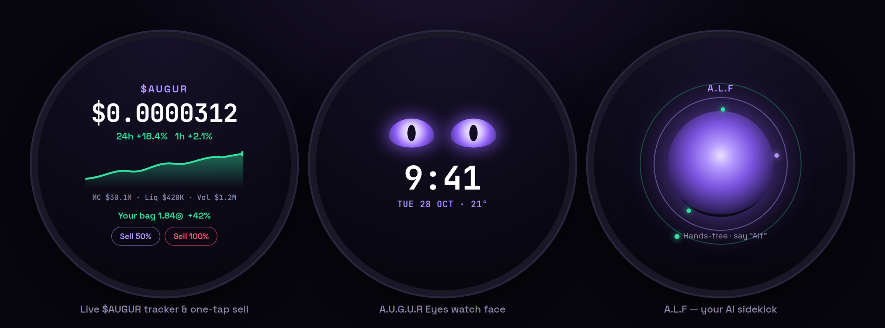
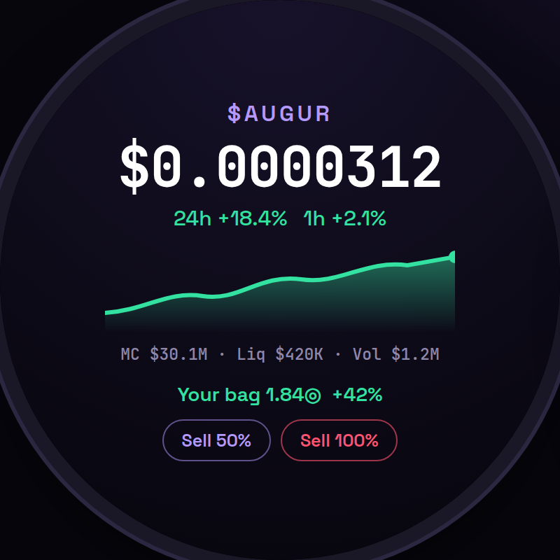
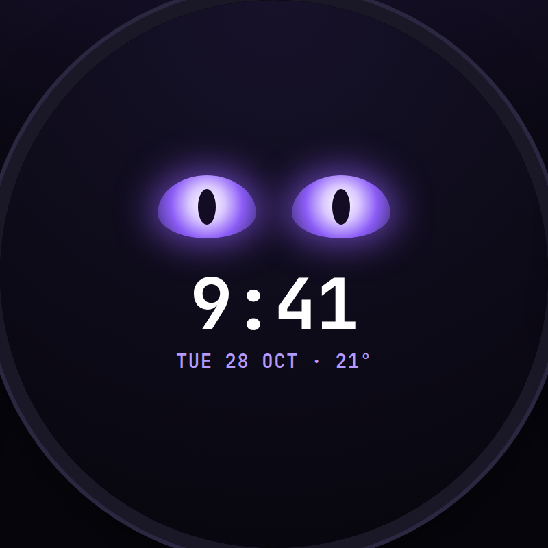
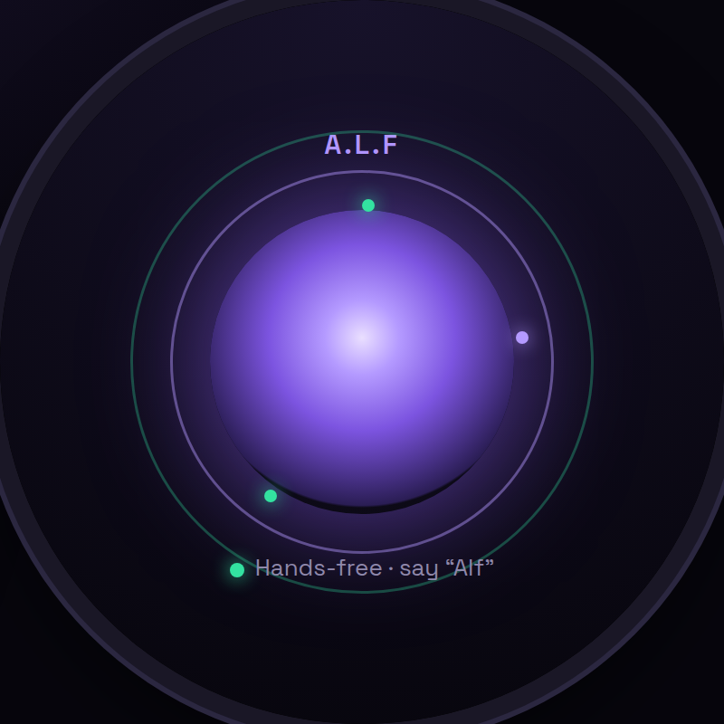

  

  
  
  
  

<b>A.U.G.U.R on your wrist</b> — a Wear OS app that tracks $AUGUR, trades from the watch, and carries A.L.F, your AI sidekick.

---

## What it does

- **👁 $AUGUR live tracker** — big live price, 24h & 1h change, market cap, and a live chart drawn for the round face.
- **⚡ One-tap sell** — your bag and P&L up front; sell 25 / 50 / 100% in a tap, confirmed on the watch. Quick-buy too.
- **🎯 Snipers, calls & picks** — your channel snipers, Telegram calls, Top Picks and whale FOMO, live on your wrist.
- **🗣️ A.L.F** — hold to talk to your Scouse AI sidekick. He knows you by your voiceprint, answers anything, checks the market and runs tasks. Hands-free mode: just say *"Alf."*
- **❤️ Health** — heart rate and steps from the watch sensors.
- **⌚ Watch faces** — two A.U.G.U.R faces (the all-seeing eye, and a neural core that reacts to A.L.F).
- **🔒 Your account, safely** — pair once; buys are capped and every trade is confirmed on-device.

The screen stays on while the app is open, so a wrist-down never blanks it mid-trade.

## Screens

  
  
  

Live $AUGUR tracker &amp; one-tap sell · A.U.G.U.R Eyes watch face · A.L.F hands-free sidekick

## Install

A one-tap Play Store install is on the way. For now, sideload (Wear OS 2+, any TicWatch / Fossil / etc.):

1. On the watch: **Settings → System → About** → tap **Build number** 7×.
2. **Settings → Developer options** → enable **ADB debugging** (+ **Debug over Wi-Fi** if not on USB).
3. `adb connect <watch-ip>:5555`  *(or plug in over USB)*
4. `adb install -r augur-watch.apk`
5. Open **A.U.G.U.R**, pair with your account, long-press the face to switch faces / A.L.F.

Full guide + download: **[augur-trade.com/watch](https://augur-trade.com/watch)**

## About

Part of [A.U.G.U.R](https://augur-trade.com), the autonomous trading agent for Solana + 13 EVM chains. The trading engine and A.L.F's brain are closed source; this repo showcases the watch app and hosts its releases.

<a href="https://augur-trade.com">augur-trade.com</a> · Trading crypto is risky. Nothing here is financial advice.

